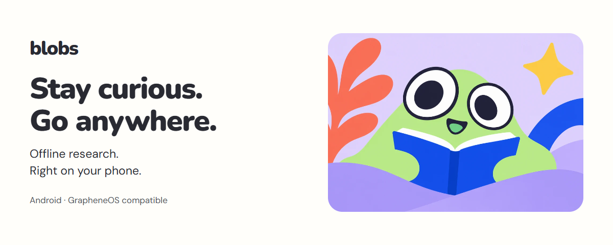

# Blobs

<picture>
  <source media="(prefers-color-scheme: dark)" srcset="docs/assets/banner-dark.png" />
  
</picture>

Blobs is an offline Android research app compatible with GrapheneOS. Search a local knowledge library, ask questions, and read the sources inside the app. Conversations, documents, and model inference stay on your phone. No account or Google Play Services is required.

**[Download the Android app](https://github.com/nonomnonom/blobs/releases/latest)** · **[Read the guides](https://nonomnonom.github.io/blobs/)** · **[See the app](https://nonomnonom.github.io/blobs/docs/tour/)**

## Get started

1. Download the APK from the latest release and open it on Android 9 or later. Allow installation from your browser or file manager when Android asks. ARM64 and x86_64 are supported.
2. Open Blobs. Review the model recommended for your phone, then choose **Download**. You can compare other models before choosing.
3. Download the starter library and finish setup. Optional collections are available from **Library → Discover more**.
4. Ask your first question. The model can chat offline without a library; install a library to search saved sources and open citations.

Only downloads and checking for new models or libraries need a connection. They start when you choose them. Installation verifies the package before activating it. Model and library sizes, languages, sources, and licenses are listed in the app and the [guides](https://nonomnonom.github.io/blobs/docs/library/).

You can install a newer APK over an existing version signed with the same certificate. Keep the app installed to preserve private conversations and downloaded libraries. Release checksums and the signing certificate fingerprint accompany every APK.

Blobs 0.4.0 uses a new signing certificate, so Android refuses to install it over 0.3.14 or older. Export the conversations you want to keep, uninstall the old app, then install 0.4.0; later releases install in place again.

## What you can do

- Ask questions using downloaded libraries and follow citations to saved articles.
- Add your own text, Markdown, CSV, JSON, and text-based PDFs.
- Save, rename, export, or delete conversations and manage your downloaded collections.
- Choose a local model and use Android's text-size preferences and light or dark appearance.

Answers can be incomplete or wrong, even when they include citations. Libraries are snapshots rather than live web search. Check the source and its date, and choose a model that fits your phone's memory and storage.

## Build

Follow the [Android build guide](android/README.md) to build and run the app. See [Contributing](CONTRIBUTING.md) for code changes, [corpus preparation](corpus/README.md) for library packages, and [website development](docs/web/README.md) for the guides.

## License

Original Blobs source code, tooling and documentation are licensed under [Apache-2.0](LICENSE). Original Blobs artwork and branding are excluded from that grant; see [NOTICE](NOTICE). Third-party components, model weights and datasets retain their own licenses; see [android/THIRD_PARTY_NOTICES.md](android/THIRD_PARTY_NOTICES.md) and [corpus/THIRD_PARTY_NOTICES.md](corpus/THIRD_PARTY_NOTICES.md).

Ask questions in [Discussions](https://github.com/nonomnonom/blobs/discussions), report bugs or source corrections through [GitHub issues](https://github.com/nonomnonom/blobs/issues), and follow [Contributing](CONTRIBUTING.md) for code changes. For security vulnerabilities, use [private reporting](SECURITY.md). Participation follows the [community code of conduct](CODE_OF_CONDUCT.md).
