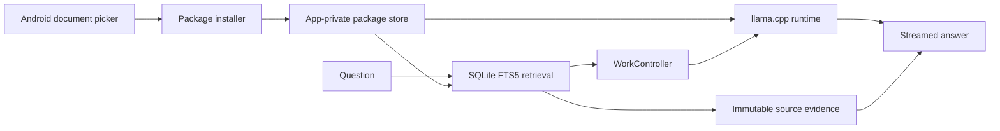

# Android architecture

## Product boundary

Blobs is a fully local Android application. The APK has no network permission. The app accepts model and knowledge packages selected by the user, validates and installs them into app-private storage, retrieves evidence from the active library, and generates an answer with the active local model.

## State and ownership

Compose screens render immutable UI state and send actions to feature or product ViewModels. ViewModels own screen state and user intent. Repositories own persistence. `WorkController` serializes generation and package/data mutations so cancellation and late callbacks cannot write into a replaced conversation or package state.

Room stores conversations, turns, drafts, selected package metadata, and install jobs. DataStore holds lightweight user preferences. Knowledge packages remain separate read-only SQLite databases so large libraries do not participate in Room migrations.

## Package installation

Imports use Android `content://` URIs and stream into a job-owned staging area. The installer enforces format version, package kind, bounded metadata, supported schema/runtime, declared length, CRC, SHA-256, free-space headroom, and safe entry names. Only a completely verified payload is atomically activated. Cancellation or failure removes staging data and preserves the active edition.

The source package and installed payload can coexist during import, so the UI reports peak storage instead of only final storage. An installed package is never inferred from a filename.

## Retrieval and citations

The library database uses SQLite FTS5 for lexical retrieval. Results carry stable source IDs, document metadata, section information, and bounded passage text. The generation prompt assigns `[S1]`, `[S2]`, and subsequent identifiers. Output parsing keeps only complete identifiers that refer to supplied evidence. The saved turn stores the evidence used at generation time, so later library changes cannot rewrite a past answer's sources.

A citation opens the stored passage and local article reader. External source addresses are shown as attribution and are never opened as an implicit side effect.

## Native inference

The JNI layer is intentionally narrow: load/unload a model, stream tokens, and cancel work. Native handles remain outside UI code. Runtime source revisions are pinned and fetched by `tools/fetch_runtime.py`; generated third-party source trees are ignored by Git. CPU inference supports ARM64 and x86_64 builds.

## Security and privacy invariants

- No network permission, account, analytics, or remote API.
- Retrieved content and model output are untrusted text.
- SQL is parameterized and package paths are validated.
- Package checksums detect corruption but do not establish publisher identity.
- Signing keys and credentials never enter source archives.
- Destructive Room fallback is disabled; schema changes require migrations.
