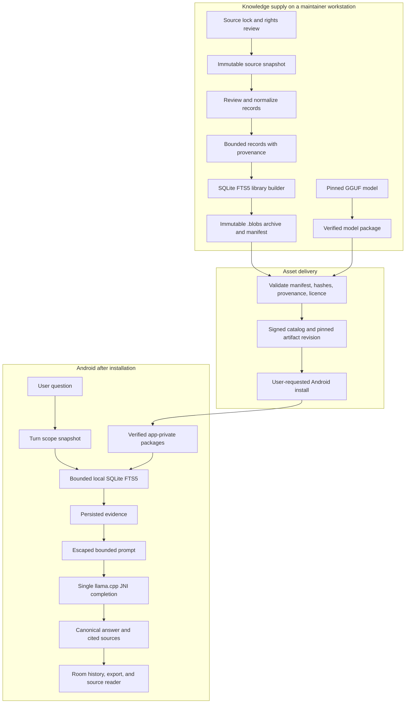

# Blobs architecture

Blobs is a global, offline-first research application for Android. It answers
from installed knowledge libraries, shows the supporting local sources, and
keeps the full research path on the device after assets are installed.

This document describes the intended product contract and the current ownership
structure. It is not proof that an APK, a device, a model, a library, or a
bounty submission has passed acceptance. Production validation is governed by
[goal.md](../goal.md): builds, tests, benchmarks, evaluators, and device acceptance
may run when inputs and resources are available, while preserving running processes
and data preparation.

Blobs does not adopt code, runtime, wire formats, assets, or data-pack formats
from another product. Competitor artifacts, when available, are read-only
evaluation inputs.

## Product boundary

After a user installs a model and one or more libraries, one research turn has
one local path:

```text
question -> fixed library scope -> local FTS retrieval -> saved evidence
         -> bounded prompt -> one JNI completion -> citation cleanup
         -> durable turn -> chat and source reader
```

There is no hosted inference, remote fallback, local HTTP server, tool call,
agent loop, hidden second retrieval, or hidden second completion on this path.
Network access is limited to a user-requested catalog refresh or asset download
before installation.

## End-to-end system



The supply plane creates data; the delivery plane distributes immutable assets;
the device plane consumes installed assets. A deployment service may deliver an
archive but must never become a research, ranking, or inference dependency.

## Global knowledge catalog

A large catalog is a product requirement, not a side effect of a demo library.
The catalog must grow by quality-controlled source families instead of by
unreviewed volume.

| Catalog tier | Purpose | Source standard | Example scope |
| --- | --- | --- | --- |
| Core reference | Broad global coverage for definitions, people, places, history, and science | Well-known redistributable collections with a pinned edition and attribution | Encyclopaedia and global travel libraries |
| Primary-domain libraries | High-confidence answers in a defined domain | Official or first-party sources where possible, with an explicit update policy | Safety, public health, parks, preparedness, civic guidance |
| Regional libraries | Deep, location-specific content | Maintained public sources with a declared geographic and temporal scope | Country, city, transit, cultural, or visitor information |
| Structured local facts | Narrow, frequently changing factual records | Snapshot, review, and explicit limitations for every claim | Named places, facilities, public datasets |
| User libraries | Personal or private documents | User-owned content; no false publisher provenance | Imported TXT, Markdown, CSV, JSON, and textual PDF |

Every catalog entry must state its ID, edition, title, language, geographic
scope when relevant, publisher, source URL or revision, licence/attribution,
record count, archive size, source snapshot date, update policy, known
limitations, package SHA-256, and availability state. A user chooses which
large libraries to install; the app must not hide storage cost or automatically
replace an installed edition.

A public library payload is capped at 6 GiB (6,442,450,944 bytes). A raw
source snapshot may be substantially larger because it is a development input,
not an Android package. A source that cannot fit this limit is divided only
through a source-bound deterministic complementary-volume plan; topical slices
cannot silently omit records from an advertised edition.

For a public library, the signed catalog carries this information in
`library_profile`: `record_count`, `scope`, `source_snapshot_date`,
`update_policy`, and `limitations`. Android rejects a public library catalog
entry without that profile, and rejects a model entry that tries to supply one.
The profile describes the immutable package edition; it is not a freshness
claim or a promise of future update frequency. The app shows the profile with
the package edition, installed size, licence, and origin before download.

The catalog is English-first but is not restricted to English evidence. A
library declares its content language; source text and titles retain their
original bytes. Product code, documentation, default UI copy, and metadata
labels remain English.

## Source-to-library data contract

`corpus/` runs on a maintainer workstation and never ships as Android runtime
code. A library edition passes through these gates:

| Stage | Input | Output | Required invariant |
| --- | --- | --- | --- |
| Source definition | Rights decision and source identity | Versioned source lock | Edition, scope, licence, origin, and input identity are reviewable |
| Acquisition | Locked archive, page revision, API result, or dataset export | Raw snapshot plus receipt | Exact bytes, fetch context, and digest are retained outside the app |
| Content review | Raw source and declared selection rules | Reviewed extraction | Scope, attribution, exclusions, and unsupported claims are explicit |
| Normalization | Reviewed text | Bounded records | Required fields are valid UTF-8, non-empty, bounded, and attributable |
| Library build | Normalized records | SQLite library with FTS5 | Source reader text, passages, aliases, provenance, and FTS refer to the same record identity |
| Package build | SQLite library | Immutable `.blobs` archive and manifest | Manifest identifies payload, format, package digest, and normalized record-set digest |
| Publication | Verified archive and catalog metadata | Pinned catalog entry | Catalog revision, archive digest, manifest, and rights information agree |
| Device installation | Catalog or user-selected archive | Atomically activated local package | Download, manifest, hash, schema, and payload validation succeed before activation |

A normalized document contains `id`, `title`, `publisher`, `url`, `license`,
`updated`, `saved`, `body`, and `collection`. An optional `provenance` JSON
object records origin information such as a source-lock ID, source revision,
raw snapshot digest, selection rule, or body digest. The corpus contract rejects
malformed, invalid UTF-8, oversized, or non-object provenance before a package
is built.

The builder writes the canonical document body for the source reader, passages
for retrieval, `document_names` aliases for reviewed names, and
`document_provenance` for auditability. It calculates `records_sha256` over the
normalized record stream. Android carries that digest with the installed package
and turn snapshot when the archive declares it; legacy and user-imported
libraries do not invent one.

### Place and frequently changing data

A place pack is not an answer-generation shortcut. It is a snapshot with
limited factual claims. `places.py` accepts named restaurants, cafes, and
fast-food records only where source tags explicitly declare `diet:vegan=yes`,
`diet:vegan=only`, or a vegan `cuisine` indicator. It preserves the source
object URL, coordinate, source timestamp, query digest, snapshot digest, and
raw indicator.

The acquisition command writes a `captured-unreviewed` receipt beside the raw
snapshot. A named reviewer must inspect the exact raw snapshot, then create a
source lock whose snapshot hash, query hash, endpoint, source time, and review
notes match that receipt. Only that locked snapshot can be extracted.

A place pack never infers current opening status, distance, route guidance,
popularity, a fully vegan kitchen, or “best” ranking unless a separately
reviewed data source proves that field and the record declares its freshness.
No reviewed Ubud vegan-place snapshot or published Ubud vegan package exists in
this checkout.

## Package distribution and installation

The APK contains a fallback catalog so a user can inspect initial assets
offline. A refresh is explicit. `PackageCatalog` accepts a bounded catalog
envelope only from allowed endpoints, verifies its ECDSA P-256 signature, and
rejects a rollback revision. Catalog URLs must be pinned to an immutable Hugging
Face commit or matching release artifact. The catalog exposes archives; it does
not expose a search or inference endpoint.

`PackageDownloader` stores an asset in private temporary storage and verifies
its expected size and SHA-256. The installer reads the archive manifest, copies
the payload to staging while hashing it, validates the payload type, then
activates it by atomic rename and persists the package state in Room. A failed
or cancelled installation leaves the previously active edition usable.

For a catalog library, the installer persists the signed `library_profile` with
the exact installed package key. This keeps scope, record count, snapshot date,
update policy, and limitations inspectable when a later catalog omits that
historical edition or the device is offline. User-imported libraries retain no
invented publisher profile.

A library validator owns the device trust boundary. It validates the SQLite
schema, FTS tables, record spans, and manifest record digest when supplied.
For a user-supplied archive it also requires exactly one bounded, well-formed
provenance row for every document. Package contents must not be trusted merely
because an archive was downloaded from the catalog.

Release APK signing is a separate trust boundary. A release uses its trusted
certificate fingerprint. An offline kit joins a signed APK and pinned packages
with an inventory of SHA-256 values, but never includes a signing key or catalog
private key.

## Research turn

| Step | Owner | Durable result | User-visible outcome |
| --- | --- | --- | --- |
| Validate and reserve | `AppViewModel`, `ResearchWork`, `ConversationStore` | New Room turn and immutable library-scope snapshot | Invalid input stays a visible validation result; library changes cannot alter an active turn |
| Resolve retrieval text | `RetrievalQuery` | Original question remains unchanged | A bounded follow-up may use earlier questions as retrieval context |
| Retrieve | `LibraryStore` | Candidate evidence in turn scope | One bounded FTS query per selected local library, followed by local ranking and de-duplication |
| Checkpoint evidence | `ResearchWork` | Evidence saved before model load | Sources are shown in the chat while the model writes, and remain inspectable if work stops before output |
| Build prompt | `ResearchPrompt` | Bounded prompt representation only | History, topic, and source text are escaped as reference data |
| Complete | `NativeBridge` and native runtime | Bounded streamed response document | One sampler-constrained completion streams prose the reader can already read |
| Finalize | `StructuredAnswer`, `AnswerText`, `FollowUpSuggestions`, `ResearchWork`, `ConversationStore` | Canonical body, support claim, citations, grounding, finish reason, timing, next-question offers | The chat shows a completed, stopped, or error turn with the actual cited evidence |
| Read/export | `TurnResponse`, `LibraryReader`, `ConversationStore` | No mutation required | The user can open the recorded source text and export turn provenance |

A blank retrieval is not itself an error. The model receives a normal local
request with an instruction to disclose that installed sources do not support a
specific factual claim. Citation markers `[S1]` through `[S3]` identify only
evidence selected for that turn. The finalizer removes markers that do not
refer to turn evidence and stores citations actually present in the answer.

Grounding is a structural label, not an entailment guarantee:
`grounded` means every displayed factual prose sentence has a valid marker;
`unverified` means citation coverage is incomplete or retrieval did not support
it; `not_requested` is reserved for a turn deliberately run without retrieval.

The answer shape is a runtime property, not a request. `StructuredAnswer` owns
the one response document: the prose first, the model's own local-source support
claim last. `inference/` hands its grammar to the native sampler, so only a token
that keeps that document valid can ever be chosen, and the finalizer re-reads the
whole document before persisting. Enforcement and cost are separate: the runtime
samples the pruned chain first, checks that one candidate against the grammar, and
applies the mask over the whole vocabulary only when the candidate could not
extend the document. Choosing a token the grammar rejects is therefore impossible,
while the vocabulary-wide pass is not paid for on every token. The rest of the
chain is greedy with a repetition penalty: the removed top-k/top-p/temperature
passes were three vocabulary-wide scans per token — 12-13 s of a 0.5B turn — and
three paired answers came back byte-identical without them, with the repetition
penalty kept against loops. Streaming, cancellation, and a token-limited
turn render the decoded prefix, so no document punctuation reaches a reader or a
stored answer. `AnswerGrounding` then decides the disclosure: citation coverage is
the only route to `grounded`, and a claimed `partial` or `unsourced` support can
only lower it.

What the shape cannot carry, the prompt does. `ResearchPrompt.system` is a short
writing contract, now 910 characters: open with the result, stay in plain prose,
give every factual sentence its marker, append no source list, and say plainly when
the local library does not cover a claim. Rules the sampler or the finalizer already
enforce — document shape, admissible markers, termination — stay out of that prose.
Prompt wording was measured on the pinned model against a fixed question set, and
the measurement corrected the claim: a rule-only prompt produced markers in 0 of 16
prose sentences, restating the admissible markers next to each question changed
nothing, and one worked example of the marker form produced 8 of 11 only because its
subject matched a probe question, which is contamination, not compliance. With a
domain-neutral example the same arm produced 1 of 6, and the simplified contract
produced 3 of 7 with one grounded turn, at a quarter fewer prompt characters. Prose
therefore sets voice, structure, and honesty, and reliably suppresses "the passage
says" narration, but it does not make a 2B model cite on demand. Citation coverage
stays a measured, stored disclosure rather than a requested property, and raising it
is a runtime or model decision, not a wording edit. A test refuses a system prompt
that outgrows its character budget, so prompt prose stays cheap to decode on the
first turn of a conversation and leaves room for passages.

The request the model reads is bounded in code, not by intent.
`ResearchPrompt.MAX_PROMPT_CHARACTERS` caps the built text at 6,000 characters:
the question is accepted up to 4,000, each passage keeps at most 2,000 characters of
body, and titles, sections, dates, and the conversation topic are clipped before they
are escaped. A source is costed by what the rendered prompt carries for it, measured
against the escaped length because `&`, `<`, and `>` grow when they are written as
reference data. When the request cannot fit, retained history is dropped before any
passage is cut, so a turn never silently loses a source it has to cite; after that,
sources go from the tail of the ranked list, so the passages the model keeps are
always its highest-ranked ones. At least one passage survives a squeeze whenever the
retrieval returned any, because an answer the app refuses to write is worse than one
that takes longer. A trimmed passage is not shown to the reader either: the turn's
evidence list is the carried prefix, so `S1..Sk` label exactly what was sent. Retained
history carries the last two
earlier questions only: an earlier answer is this model's own prose, and a recorded
run replayed the first answer word for word two turns later.

Next-question offers are app-derived, never model- or app-invented prose.
`FollowUpSuggestions` reads the finished question, its evidence, its answer, and
the questions this conversation already asked, then composes a complete question
around verbatim local library text: an article title paired with a section title
of evidence the answer never cited, or with a heading-like line inside a passage
whose words the answer never reached. Headings are read from every passage, not
only cited ones, because a turn whose one usable section title was already the
question's subject would otherwise offer nothing at all. A bare heading is not an offer.
Sent back on its own it loses the article it came from, retrieval matches any
other document carrying that word, and the conversation drifts: a recorded run
went from Kyoto transport to a national lodging essay to a town in Wyoming in
three taps. An offer that repeats something this conversation already asked is
dropped for the same reason. Each offer is stored with the turn together with the
basis and evidence index that produced it, so a reader can check why it appeared. An
offer is a proposal for the next explicit user action; it does not enter the
prompt, retrieval, or runtime of the turn that produced it. Answers written by
an older build that already carried a model-written suggestion block stay
readable; their offers are labelled `legacy_model` and link to no evidence.

A cancellation signal reaches native decoding, waits for the current
checkpoint, and persists available partial text and evidence as `stopped`.
`CONTEXT_FULL`, incompatible model template, model-load failure, and invalid
package states are explicit results. The engine never quietly resubmits a
question with removed history, shortened sources, or a second prompt.

## Retrieval

Retrieval is lexical SQLite FTS5 because it is local, inspectable, packageable,
and deterministic for a fixed package. Each selected library gets at most one
bounded FTS statement. A reviewed `document_names` alias lookup may refine that
statement but cannot initiate a second topical query.

The local ranker then applies subject/title relevance, duplicate removal,
per-document limits, evidence overlap thresholds, and a shared character budget
before choosing up to three prompt sources. Named-subject selection keeps one
slot per subject and then lets the most topically relevant named article keep
room for its own sections, so generic siblings that merely carry the subject name
cannot crowd out the article the question asked about. A source reader can return
more results because browse behaviour is separate from answer evidence selection.

A large catalog requires retrieval measurements before algorithms expand:
- maintain versioned, held-out cases by library and query category;
- report coverage and recall against the exact package identity;
- preserve miss cases and unsupported queries rather than hiding them;
- only consider semantic retrieval or a reranker after a measured lexical gap
  on the same corpus and target device budget.

No spatial index, automatic recommendation score, semantic model, or second
ranker is part of the runtime until a concrete pack and evaluation case prove
that the current FTS contract cannot answer the required task.

## Inference runtime

One Gradle application contains Compose UI, Room, SQLite FTS5, package
installation, and a pinned llama.cpp runtime embedded through JNI. The standard
APK uses CPU/KleidiAI. An ARM64 Snapdragon variant may package OpenCL and
Hexagon modules without changing the application or data contract.

The inference performance configuration follows llama.cpp's own guidance.
Threads are auto-detected from the device and clamped to 8, so an eight-core
phone is not forced onto a four-thread policy. Prompt decoding runs in
512-token batches with a 256-token physical ubatch. The KV cache stores Q8_0
and leaves Flash Attention on llama.cpp's automatic selection. On arm64 the
build uses the pinned KleidiAI kernels; x86_64 builds enable AVX/AVX2/FMA/F16C/
BMI2 paths that ggml dispatches from CPUID at runtime, so older x86_64 devices
still run. Full-layer GPU offload exists only in the opt-in Snapdragon
OpenCL/Hexagon build (`blobs.snapdragonBackends` Gradle property, Qualcomm SDKs
required at build time); the standard APK stays CPU-only. `mlock` is
intentionally unused because Android's memlock rlimit makes it a no-op for app
processes. The pinned model quant is the fixed speed/quality point; changing it
is a model supply change, not a runtime flag.

The native lifecycle has one owner:
`backend initialize -> model load -> template validation -> context creation ->
prompt tokenization -> optional exact-prefix KV reuse -> decode -> cleanup`.

The Android native target links only the `blobs` JNI bridge and the pinned
llama.cpp inference library. Its CMake contract disables CURL, llama.cpp
server, examples, tools, and common command-line targets; the project declares
only C and C++ languages. Upstream llama.cpp source documentation may mention
servers, agents, RPC, or Rust-adjacent tooling, but none is a Blobs Android
runtime dependency.

The engine bounds output to 256 tokens and 32 KiB of complete UTF-8 text.
Streaming accepts token bytes, retains a valid UTF-8 prefix, and throttles UI
renders without dropping output. Prefix cache reuse is valid only for byte- and
token-identical prompt prefixes. It is a performance optimization, never a
source of conversational state or a way to avoid the single-completion rule.

## Persistence, UI, and source access

Room is the durable source of truth for conversations, turns, library scope,
evidence, package state, package record digest, next-question offers, and the
support claim recorded by a completed turn.
Historical migrations leave fields unknown when a past turn did not record
them; migration must not invent grounding or source identity.

`TurnResponse` is the single projection of a stored turn: lifecycle, answer body,
citation annotations, offers, and usage counts. Chat rendering and conversation
export read that record instead of parsing stored text independently.

The UI distinguishes retrieval, generation, pending model preparation, stopped,
limited, and error states. Evidence is visibly distinct from generated prose.
The source reader opens the installed library and document identified by recorded
evidence, including a disabled edition retained solely for source inspection, and
renders the recorded passage exactly as stored: an ellipsis appended to the
excerpt would make selection and copy return text no source contains, so the
read-full action is what signals that the passage is an excerpt. Retrieval only
searches enabled packages.

The setup flow asks for what the device is missing rather than replaying a
recorded progress marker: `setupStep` returns the model step while no model is
installed and the library step while no library is installed, so a device that has
a model but no local source is offered a library instead of being told to ask a
first question it cannot answer from sources.

Transcript movement is decided in one place, `ui/chat/ConversationScrollPolicy`, so a
streaming answer never competes with the reader. A new turn anchors near the top with a
peek of the previous turn, streamed content is followed only while the reader is already
at the live edge, and a drag, a fling, or an explicit jump to latest is what changes that
state. Opening a saved thread lands on its last anchored turn, not the raw bottom. Steps a
turn took share one shape (`Trace`, `TraceLine`, `TraceCollapsible`) and report only the
stage the runtime states and the counts the turn itself recorded.

## Ownership summary

| Area | Owner | Decision |
| --- | --- | --- |
| UI | `feature/` and `ui/` | Rendering, actions, navigation, accessibility |
| Work lifecycle | `WorkController`, `WorkSession`, `ResearchWork`, `PackageTransferWork` | Exclusive work, cancellation, durable turn/transfer lifecycle |
| Research engine | `engine/` | Fixed retrieval-to-completion path |
| Local data | `data/library`, `data/local`, `data/packages`, `data/transfer` | FTS, evidence, persistence, packages, transfer |
| Inference | `inference/` and `app/src/main/cpp` | Prompt budget, response contract and grammar, citations, grounding decision, JNI, native constrained sampling |
| Knowledge supply | `corpus/` | Sources, review, records, packages, provenance, evaluation inputs |
| Asset release | `android/tools/`, `android/docs/` | Catalog signing, pinned publication, APK and offline-kit verification |

Do not place ranking in UI, persistence in native code, or product prompt policy
in C++. A new invariant needs an owner before implementation.

## Evidence and current status

Any claim about quality, latency, memory, offline operation, or bounty
readiness requires a reproducible record containing the APK, model identity,
library manifest and digest, device/OS/ABI, configuration, queries, raw output,
and measurement method. An observation without reproducible input, executable,
device, or corpus is historical.

Status report, not a measurement record: on 2026-10-30 the product owner reports
the 0.5.0 release completing setup, model and library download, and
airplane-mode research turns on a physical Android phone. No capture, log,
timing, device model, or OS version from that run is stored in this repository,
so it is not yet the reproducible record the paragraph above requires. The
entries below remain the reproducible evidence; the owner run adds a second
device class to the acceptance picture without replacing those numbers.

A supply admission is not evidence that the runtime accepts the package. Recorded on
2026-10-24: installing the admitted `wikivoyage-en@2026-09.4` on `sdk_gphone64_x86_64`
(Android 16, API 36, emulator, airplane mode) failed in `LibraryValidator` as
`status=PREPARATION_FAILED` (`offline-grounding-001`), while auditing the archives that pass
every publisher check found documents the app forbids in eight of the nine admitted libraries.
`corpus/blobs_corpus/records.py` had exempted `documents.body` from the no-U+FFFD rule that the
app applies to every `documents` column. Rebuilding that lane under the corrected contract gives
`wikivoyage-en@2026-09.5` - 34,597 articles from the same pinned 2026-09 archive, archive SHA-256
`f44f582e2836db30f0091c647ac678411089a5059f390bdc0f4e9403fb90edcc` - which installs and completes
the fixed research path offline: `installable-wv095-002` reached `COMPLETE`/`STOP` with three
retrieved passages, `model_support=sourced`, first visible text after 8.3 s and 81.1 s end to end
on debug APK `4c99cf2e50ae624f1e7c8dd5697b798e6da472d7c74e6580cfe3e3f18d237bf5` and model
`aaf42c8b7c3cab2b...`. `grounding` stayed `UNVERIFIED` because the answer carried no citation
markers, and the first attempt of that run ended `finish_reason=CANCELLED` once without
reproducing. Emulator timings are this device's observation only.

Recorded on 2026-10-24 for the rebuilt Wikivoyage edition's retrieval, so re-admission has a
number to bind to. Replaying the pinned Android retrieval policy (`LibraryStore.kt` `6c44e154`,
`RetrievalQuery.kt` `d2beec91`, both re-verified as matching at run time) over
`evaluation/cases/wikivoyage-en-retrieval-v3.json` - the 50 inherited cases minus the two that
asked for the removed guides - against package
`f44f582e2836db30f0091c647ac678411089a5059f390bdc0f4e9403fb90edcc` found 45 of 48 expected titles,
29 at rank 1, mean reciprocal rank 0.7431. The three misses are the carried-over ones already
recorded for 2026-09.4: `bali-scooter-permit`, `paris-first-stay`, and `tokyo-rail-network`.
Running the withdrawn 2026-09.4 package through the same tool and the same 48 cases gives
identical numbers with no case changing rank, so the rebuild changed no retrieval behaviour.
Comparing these figures against the older 2026-09.4 summary (47 of 50, 30 at rank 1) would be a
method error: that summary came from `host_replay.py`, a different scorer, so only the
same-tool comparison above supports any claim about the rebuild's effect. Host replay numbers are
not on-device latency, and the case file still marks all 48 as expected hits, so the three known
misses are carried in this note rather than silently reclassified.

Recorded on 2026-10-24 as an advertisement audit of `README.md`, re-checked on 2026-10-25 against
the artifact a user actually installs (public release v0.4.0, `APK-VERIFICATION.json` sha256
`5fb939c2531a8b6d...`, 31,215,434 bytes): "Android 9 or later" holds at `minSdk = 28`; "ARM64 and
x86_64 are supported" holds because the released APK carries four native libraries per ABI (eight
total), although the `snapdragonBackends` build variant ships `arm64-v8a` only; the promised import
formats are exactly the accepted set in `UserLibraryPackage` (`txt`, `md`, `markdown`, `csv`,
`json`, `pdf`) with a `PDF_NO_TEXT` guard matching "text-based PDFs"; "starter library" matches the
single `starter` catalog role; and "Release checksums and the signing certificate fingerprint
accompany every APK" matches the shipped `SHA256SUMS.txt`, `SIGNATURE.txt`, and
`APK-VERIFICATION.json`. "Installation verifies the package before activating it" is proven in the
enforcing direction by the `PREPARATION_FAILED` record above. Two claims stay unproven here:
GrapheneOS compatibility needs a device, and "follow citations to saved articles" is only partly
delivered - measured marker rates are 1 of 6 answers on the Qwen model and 3 of 6 on the LFM2
candidate, so citation-following works when a marker is emitted and is not yet reliable enough to
advertise without qualification.

Recorded on 2026-10-24 as the broadest device run in this repository so far: the complete
non-`@ManualCheck` instrumented suite ran on `sdk_gphone64_x86_64` (Android 16, API 36, emulator,
4 cores) and finished `OK (60 tests)` in 510.7 s with no failures, covering citation provenance,
corpus package install, draft submission, foundation, launch, library relevance, twelve library
retrieval checks, product storage and UI parity. Debug APK under test
`6849c249245dc6862b2387ad645444197f6d7e9cec0c609edaf8d125195f463a`, instrumentation APK
`858f4be3c45b605b7434ece49c51c0b49e590a484f0faf787b11a4edcbdbf7c8`. It is the working tree's
state, which at that moment carried other engineers' uncommitted edits, so it is regression
evidence for the tree rather than for a commit, and an emulator is still not phone acceptance.

Recorded on 2026-10-24 about the supply lifecycle: rebuilding an admitted lane is blocked by the
duplicate-supply gate until the superseded edition is retired. Re-extracting Wikisource under the
corrected record contract produced 688,802 documents and 11,840 extraction rejections (135 of them
the replacement-character rule), curating to 622,014 articles, and `blobs_corpus.export` then
refused it: it repeats 622,014 canonical URLs and body hashes retained in
`wikisource-en-all-nopic-2026-09.2`. The same check applied to the rebuilt
`wikivoyage-en-all-nopic-2026-09.5` repeats 34,597 URLs and hashes against the retained
`wikivoyage-en-all-nopic-2026-09` - that edition only got as far as a package because the rebuild
skipped the `export` step, so it is installable and measured but not yet admissible while its
predecessor is retained. Retiring a predecessor is a portfolio decision: the records revisions it
pins are already published, so it is not something a rebuild can do silently.

Recorded on 2026-10-24 for the response contract: `NativeInferenceTest#
verifiedModelFileCompletesOfflineChatFlow` ran in airplane mode on
`sdk_gphone64_x86_64` (Android 16, API 36, emulator), debug APK from this
working tree, model `unsloth/Qwen3.5-2B-GGUF` revision
`f6d5376be1edb4d416d56da11e5397a961aca8ae`, file
`Qwen3.5-2B-Q4_K_M.gguf`, SHA-256 `aaf42c8b7c3cab2bf3d69c355048d4a0ee9973d48f16c731c0520ee914699223`
(verified on device), library `corpus-fixture` version 1, SHA-256
`9944c8e073517c3badfc7f5205472c6c3656a72d9da43eb1413317479dc5e92d`, question
"How do trees reduce urban heat? Explain with sources.", report run ids
`structured-003` and `structured-004` (identical result: `complete`/`stop`,
`model_support=sourced`, first visible text 17.1-17.8 s, end to end 39.8-39.9 s
at a 320-token bound). The completion returned a document the decoder accepted,
the turn ended `complete`/`stop`, and the stored answer contained no response
punctuation. Retrieval matched nothing, so `grounding=unverified` held even
though the model claimed support, and no next-question offer was created.
Emulator timings are this device's observation only: an
emulator is not target-device acceptance and proves no phone performance.
An earlier run of the same capture recorded `error=GRAMMAR` and status `error`
after a wrapped GBNF production failed to parse, which is why one production per
line is now a checked invariant.

Recorded on 2026-10-24 for follow-up quality and turn cost, on the same
`sdk_gphone64_x86_64` emulator (Android 16, API 36), airplane mode, model
`aaf42c8b7c3cab2b...`, library `wikivoyage-en-2026-09.4` SHA-256
`940298281ad53bac732feebd2356f2f99356c077817b525ab2ccfcfaa1fdc692`,
`FollowUpJourneyTest#fiveTurnsOfOfferedFollowUps`, which sends each turn's first
stored offer back as the next question the way a tap does:

- `journey-baseline-001` (offers were bare section titles): "How do I get around
  Kyoto?" offered `Sleep`, `Transportation`, `Kyoto`; tapping `Sleep` retrieved a
  national lodging essay, and tapping `Ten Sleep` from that answer produced a
  town in Wyoming. Turns took 80.9 s, 45.4 s, and 85.8 s end to end with 17.1-60.4 s
  before the first visible text, and all three landed `unverified`.
- After offers became subject questions that name their article
  (`journey-cite-004`): the same first tap retrieved Kyoto lodging, and the next
  stayed on Arashiyama sights. No turn left the subject. End to end 22.9-36.5 s
  with first visible text at 5.4-10.7 s, and one `grounded` turn.
- Retained answers were the other drift mechanism: with them in the prompt, the
  turn-2 answer replayed the turn-1 answer word for word before continuing
  (`journey-cite-002`). Retained history now carries earlier questions only.
- `GenerationCostTest` isolates the cost on this device. Plain decoding ran 64 ms
  per token at four threads (130 ms at one, 79 ms at two); the same request under
  the response grammar ran 180 ms per token. On one real 2,610-character,
  three-passage prompt the turn took 18.4 s unconstrained and 29.8 s constrained
  (`cost-baseline-001`, `cost-app-001`). Requesting eight threads on this
  four-CPU target was not a slowdown but a collapse: 442 s for 75 tokens.
- Sampling the pruned chain and verifying one candidate against the grammar, with
  the vocabulary-wide mask kept for rejections only, removed that tax on the same
  prompt: 63.9 ms per token constrained against 64.3 unconstrained, 11.7 s against
  14.0 s, and the response document still decoded (`cost-app-002`). The full app
  path confirms it end to end: `journey-mask-001` ran five turns, every turn
  stored a decoded support claim, stayed on the Kyoto/Arashiyama subject, produced
  at least one offer, and took 8.1-16.6 s end to end with 3.9-8.9 s before the
  first visible text.
  Emulator figures are this device only and support no phone claim.
- `journey-final-005` re-ran the journey with a second library
  (`us-preparedness-guidance-2026-10.2`, SHA-256 `934f0f3355dc9a47...`) against the
  same model, and records the installed APK digest (`2e19b7a2872338ad...`) so the
  timings name their artifact. Four turns ran at 11.9-14.5 s each with first visible
  text at 5.3-7.1 s, every turn offered subject-anchored questions, and the fourth
  offered none because the library's remaining sections had all been asked already.
  Reports are pulled to `corpus/evaluation/results/` after each run, which is kept
  out of git with the other result artifacts.
- `cost-app-003` and `journey-current-001` re-measure the current build
  (APK `73ca6f83e93cd808...`, the same model and library): on a real three-passage
  1,590-character prompt the turn ran 63.4 ms per token unconstrained and 63.1 ms
  constrained, 12.3 s and 10.0 s end to end, so grammar constraint costs nothing on
  this artifact either. The journey's four turns took 11.3-15.0 s each with first
  visible text at 5.4-7.3 s, retrieval at 17-41 ms, every turn decoded a support
  claim and offered only subject-anchored questions, and the fourth offered none
  because the library's remaining sections had all been asked.
- No recorded turn on this model cites inline. Every pulled journey artifact
  (18 turns across `journey-final-003`, `journey-final-005`, `journey-current-001`
  and `grammar-kit-001`) has zero `[S1]`-style markers in the answer while each one
  claims `sourced`, so the disclosure the reader sees comes from `AnswerGrounding`
  and never from the model's claim. Making the grammar enforce it was tried and
  measured (`journey-cite-req-001`): hiding the closing quote until a marker appears
  produced no marker in three turns out of three, because the model answers around
  the block instead of citing — 1,660-1,790 character answers ran to the output
  limit at 26.5-29.5 s against 11.3-15.0 s, and the document never closed, so the
  turn lost its support claim too. The requirement is reverted, an answer must
  always be able to end, and `aTurnWithPassagesAdmitsMarkersButCanAlwaysCloseTheAnswer`
  locks that. Re-running the journey on the reverted build
  (`journey-revert-001`, APK `d72c6e9e748f1687...`) restored 12.5-15.7 s turns with
  first visible text at 5.3-7.7 s and a decoded claim on all four turns, so the
  revert is measured rather than assumed. Inline citation coverage on the pinned 2B
  model is recorded as a model-capability blocker, not claimed as working.
- Two candidate models measured on one artifact. `lfm2-1b2-q4km` (Liquid AI LFM2-1.2B
  Q4_K_M, 730,893,248 bytes, SHA-256 `55175400e3f509a9...`) is pinned in
  `android/models.lock.json` and runs on the existing llama.cpp pin without a runtime
  change (`llm_arch` `lfm2` is already in the vendored `src/llama-arch.cpp`), and it
  installs through the normal model-package path. Compared with
  `qwen35-2b-q4km` on the same APK (`4c99cf2e50ae624f...`), the same library
  (`934f0f3355dc9a47...`), four threads, a 320-token limit, and one fixed six-question
  set (`prompt-citation-probe-lfm2-001`, `prompt-citation-probe-qwen-001`):
  end to end 7.0-17.7 s against 15.8-23.3 s; grammar-constrained decoding 50.3 ms per
  token against 92.3 (`cost-lfm2-001`, `cost-app-004`); process PSS after a turn
  1.30 GiB against 1.89 GiB; an answer carried a marker in 3 of 6 questions on one run
  and 2 of 6 on a re-run, against 1 of 6 for the 2B model. Every
  turn on both models still claimed `sourced` and every answer but one stayed
  `unverified`, so the disclosure rule is what keeps the badge honest. Emulator only,
  4 GB device, no phone claim.
  The offer journey on the same artifact tells the same story: five tapped-offer turns
  took 6.4-11.7 s on LFM2 (`lfm2-journey-001`) against 15.9-29.2 s on Qwen
  (`journey-current-003`), with subject-anchored offers and no markers in either run —
  markers only appeared on the fixed probe set. One earlier Qwen journey run recorded
  two finished turns and then stopped with `complete` false and no error, and the same
  sequence completed five turns afterwards, so that stop is logged as unreproduced
  rather than explained.
- The `/no_think` control token is Qwen's own chat-template convention, so it now goes
  only to a model whose id declares that family
  (`ResearchPrompt.understandsThinkingControl`); a non-Qwen model gets the question and
  nothing else. The recorded cost and journey captures taken before this change sent
  the token to every model. Re-running LFM2 afterwards on APK `6849c249245dc686...`
  moved nothing that matters: five journey turns at 7.4-10.9 s against 6.4-11.7 s,
  PSS still 1.30 GiB, and markers in 2 of 6 probe answers against 3 of 6 — which is
  why the marker counts above are quoted as a range over two runs rather than one.
- LFM2 is advertised as the third in-app model option, and the license position is
  explicit rather than assumed. Its catalog entry points at Liquid AI's own pinned
  revision (`https://huggingface.co/LiquidAI/LFM2-1.2B-GGUF/resolve/5399e76c...`), so
  the project redistributes no copy of the weights; the app downloads the same verified
  bytes the evaluation used. Because Section 4(a) of the LFM Open License 1.0 requires
  giving recipients a copy of the licence, its full text ships as
  `app/src/main/assets/licenses/LFM-Open-License-1.0.txt` (10,644 bytes, SHA-256
  `61d7e939a05911c7...`) and appears under Settings → About. Section 5 caps Commercial
  Use below 10,000,000 USD annual revenue, which the owner accepted for this option on
  2026-10-24. The bundled fallback catalog carries it at revision `2026102402` and
  `LaunchTest` pins its id, size, license, and publisher URL; installed through the
  normal catalog model path it lands as
  `lfm2-1b2-q4km-5399e76c-55175400e3f509a9` in 8.3 s (`lfm2-catalog-001`). Qwen3.5 2B
  remains the default.
- The claim space now follows the passages a turn received. `grammar-zero-004`
  asked a travel library a question it cannot support: retrieval returned no
  passage and the completion could only report `support=unsourced`, ending
  `complete`/`stop` with no marker in the answer at 7.9 s. `grammar-kit-001` asked
  that library a question it does hold: three passages, `support=sourced` on both
  turns, 11.2 s and 11.9 s. An earlier build of the narrowed grammar failed on the
  device with `error=GRAMMAR` because the substituted `support` production lost its
  GBNF string delimiters, which is why both grammars are asserted against the
  template text in `StructuredAnswerTest`.

Evidence here is dated, named, and reproducible on the inputs it records; nothing
in this repository is proved by static inspection alone. What no record yet
covers is a phone-class device, so speed, battery, and memory remain unclaimed,
and no catalog package is signed or published, so supply and release remain
unproven.
