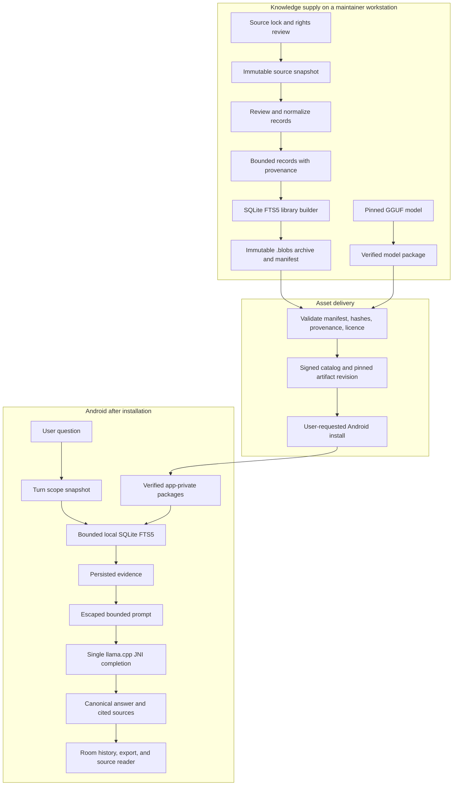

# Blobs architecture

Blobs is a global, offline-first research application for Android. It answers
from installed knowledge libraries, shows the supporting local sources, and
keeps the full research path on the device after assets are installed.

This document describes the intended product contract and the current ownership
structure. It is not proof that an APK, a device, a model, a library, or a
bounty submission has passed acceptance. Production validation is governed by
[goal.md](../goal.md): builds, tests, benchmarks, evaluators, and device acceptance
may run when inputs and resources are available, while preserving running processes
and data preparation.

Blobs does not adopt code, runtime, wire formats, assets, or data-pack formats
from another product. Competitor artifacts, when available, are read-only
evaluation inputs.

## Product boundary

After a user installs a model and one or more libraries, one research turn has
one local path:

```text
question -> fixed library scope -> local FTS retrieval -> saved evidence
         -> bounded prompt -> one JNI completion -> citation cleanup
         -> durable turn -> chat and source reader
```

There is no hosted inference, remote fallback, local HTTP server, tool call,
agent loop, hidden second retrieval, or hidden second completion on this path.
Network access is limited to a user-requested catalog refresh or asset download
before installation.

## End-to-end system



The supply plane creates data; the delivery plane distributes immutable assets;
the device plane consumes installed assets. A deployment service may deliver an
archive but must never become a research, ranking, or inference dependency.

## Global knowledge catalog

A large catalog is a product requirement, not a side effect of a demo library.
The catalog must grow by quality-controlled source families instead of by
unreviewed volume.

| Catalog tier | Purpose | Source standard | Example scope |
| --- | --- | --- | --- |
| Core reference | Broad global coverage for definitions, people, places, history, and science | Well-known redistributable collections with a pinned edition and attribution | Encyclopaedia and global travel libraries |
| Primary-domain libraries | High-confidence answers in a defined domain | Official or first-party sources where possible, with an explicit update policy | Safety, public health, parks, preparedness, civic guidance |
| Regional libraries | Deep, location-specific content | Maintained public sources with a declared geographic and temporal scope | Country, city, transit, cultural, or visitor information |
| Structured local facts | Narrow, frequently changing factual records | Snapshot, review, and explicit limitations for every claim | Named places, facilities, public datasets |
| User libraries | Personal or private documents | User-owned content; no false publisher provenance | Imported TXT, Markdown, CSV, JSON, and textual PDF |

Every catalog entry must state its ID, edition, title, language, geographic
scope when relevant, publisher, source URL or revision, licence/attribution,
record count, archive size, source snapshot date, update policy, known
limitations, package SHA-256, and availability state. A user chooses which
large libraries to install; the app must not hide storage cost or automatically
replace an installed edition.

A public library payload is capped at 6 GiB (6,442,450,944 bytes). A raw
source snapshot may be substantially larger because it is a development input,
not an Android package. A source that cannot fit this limit is divided only
through a source-bound deterministic complementary-volume plan; topical slices
cannot silently omit records from an advertised edition.

For a public library, the signed catalog carries this information in
`library_profile`: `record_count`, `scope`, `source_snapshot_date`,
`update_policy`, and `limitations`. Android rejects a public library catalog
entry without that profile, and rejects a model entry that tries to supply one.
The profile describes the immutable package edition; it is not a freshness
claim or a promise of future update frequency. The app shows the profile with
the package edition, installed size, licence, and origin before download.

The catalog is English-first but is not restricted to English evidence. A
library declares its content language; source text and titles retain their
original bytes. Product code, documentation, default UI copy, and metadata
labels remain English.

## Source-to-library data contract

`corpus/` runs on a maintainer workstation and never ships as Android runtime
code. A library edition passes through these gates:

| Stage | Input | Output | Required invariant |
| --- | --- | --- | --- |
| Source definition | Rights decision and source identity | Versioned source lock | Edition, scope, licence, origin, and input identity are reviewable |
| Acquisition | Locked archive, page revision, API result, or dataset export | Raw snapshot plus receipt | Exact bytes, fetch context, and digest are retained outside the app |
| Content review | Raw source and declared selection rules | Reviewed extraction | Scope, attribution, exclusions, and unsupported claims are explicit |
| Normalization | Reviewed text | Bounded records | Required fields are valid UTF-8, non-empty, bounded, and attributable |
| Library build | Normalized records | SQLite library with FTS5 | Source reader text, passages, aliases, provenance, and FTS refer to the same record identity |
| Package build | SQLite library | Immutable `.blobs` archive and manifest | Manifest identifies payload, format, package digest, and normalized record-set digest |
| Publication | Verified archive and catalog metadata | Pinned catalog entry | Catalog revision, archive digest, manifest, and rights information agree |
| Device installation | Catalog or user-selected archive | Atomically activated local package | Download, manifest, hash, schema, and payload validation succeed before activation |

A normalized document contains `id`, `title`, `publisher`, `url`, `license`,
`updated`, `saved`, `body`, and `collection`. An optional `provenance` JSON
object records origin information such as a source-lock ID, source revision,
raw snapshot digest, selection rule, or body digest. The corpus contract rejects
malformed, invalid UTF-8, oversized, or non-object provenance before a package
is built.

The builder writes the canonical document body for the source reader, passages
for retrieval, `document_names` aliases for reviewed names, and
`document_provenance` for auditability. It calculates `records_sha256` over the
normalized record stream. Android carries that digest with the installed package
and turn snapshot when the archive declares it; legacy and user-imported
libraries do not invent one.

### Place and frequently changing data

A place pack is not an answer-generation shortcut. It is a snapshot with
limited factual claims. `places.py` accepts named restaurants, cafes, and
fast-food records only where source tags explicitly declare `diet:vegan=yes`,
`diet:vegan=only`, or a vegan `cuisine` indicator. It preserves the source
object URL, coordinate, source timestamp, query digest, snapshot digest, and
raw indicator.

The acquisition command writes a `captured-unreviewed` receipt beside the raw
snapshot. A named reviewer must inspect the exact raw snapshot, then create a
source lock whose snapshot hash, query hash, endpoint, source time, and review
notes match that receipt. Only that locked snapshot can be extracted.

A place pack never infers current opening status, distance, route guidance,
popularity, a fully vegan kitchen, or “best” ranking unless a separately
reviewed data source proves that field and the record declares its freshness.
No reviewed Ubud vegan-place snapshot or published Ubud vegan package exists in
this checkout.

## Package distribution and installation

The APK contains a fallback catalog so a user can inspect initial assets
offline. A refresh is explicit. `PackageCatalog` accepts a bounded catalog
envelope only from allowed endpoints, verifies its ECDSA P-256 signature, and
rejects a rollback revision. Catalog URLs must be pinned to an immutable Hugging
Face commit or matching release artifact. The catalog exposes archives; it does
not expose a search or inference endpoint.

`PackageDownloader` stores an asset in private temporary storage and verifies
its expected size and SHA-256. The installer reads the archive manifest, copies
the payload to staging while hashing it, validates the payload type, then
activates it by atomic rename and persists the package state in Room. A failed
or cancelled installation leaves the previously active edition usable.

For a catalog library, the installer persists the signed `library_profile` with
the exact installed package key. This keeps scope, record count, snapshot date,
update policy, and limitations inspectable when a later catalog omits that
historical edition or the device is offline. User-imported libraries retain no
invented publisher profile.

A library validator owns the device trust boundary. It validates the SQLite
schema, FTS tables, record spans, and manifest record digest when supplied.
For a user-supplied archive it also requires exactly one bounded, well-formed
provenance row for every document. Package contents must not be trusted merely
because an archive was downloaded from the catalog.

Release APK signing is a separate trust boundary. A release uses its trusted
certificate fingerprint. An offline kit joins a signed APK and pinned packages
with an inventory of SHA-256 values, but never includes a signing key or catalog
private key.

## Research turn

| Step | Owner | Durable result | User-visible outcome |
| --- | --- | --- | --- |
| Validate and reserve | `AppViewModel`, `ResearchWork`, `ConversationStore` | New Room turn and immutable library-scope snapshot | Invalid input stays a visible validation result; library changes cannot alter an active turn |
| Resolve retrieval text | `RetrievalQuery` | Original question remains unchanged | A bounded follow-up may use earlier questions as retrieval context |
| Retrieve | `LibraryStore` | Candidate evidence in turn scope | One bounded FTS query per selected local library, followed by local ranking and de-duplication |
| Checkpoint evidence | `ResearchWork` | Evidence saved before model load | Sources remain inspectable if work stops before output |
| Build prompt | `ResearchPrompt` | Bounded prompt representation only | History, topic, and source text are escaped as reference data |
| Complete | `NativeBridge` and native runtime | Bounded streamed response document | One sampler-constrained completion streams prose the reader can already read |
| Finalize | `StructuredAnswer`, `AnswerText`, `FollowUpSuggestions`, `ResearchWork`, `ConversationStore` | Canonical body, support claim, citations, grounding, finish reason, timing, next-question offers | The chat shows a completed, stopped, or error turn with the actual cited evidence |
| Read/export | `TurnResponse`, `LibraryReader`, `ConversationStore` | No mutation required | The user can open the recorded source text and export turn provenance |

A blank retrieval is not itself an error. The model receives a normal local
request with an instruction to disclose that installed sources do not support a
specific factual claim. Citation markers `[S1]` through `[S3]` identify only
evidence selected for that turn. The finalizer removes markers that do not
refer to turn evidence and stores citations actually present in the answer.

Grounding is a structural label, not an entailment guarantee:
`grounded` means every displayed factual prose sentence has a valid marker;
`unverified` means citation coverage is incomplete or retrieval did not support
it; `not_requested` is reserved for a turn deliberately run without retrieval.

The answer shape is a runtime property, not a request. `StructuredAnswer` owns
the one response document: the prose first, the model's own local-source support
claim last. `inference/` hands its grammar to the native sampler, so only a token
that keeps that document valid can ever be chosen, and the finalizer re-reads the
whole document before persisting. Streaming, cancellation, and a token-limited
turn render the decoded prefix, so no document punctuation reaches a reader or a
stored answer. `AnswerGrounding` then decides the disclosure: citation coverage is
the only route to `grounded`, and a claimed `partial` or `unsourced` support can
only lower it.

Next-question offers are app-derived, never model- or app-invented prose.
`FollowUpSuggestions` reads the finished question, its evidence, and its answer
only, then keeps verbatim local library text: a section title of evidence the
answer never cited, or a heading-like line inside cited evidence whose words the
answer never reached. Each offer is stored with the turn together with the basis
and evidence index that produced it, so a reader can check why it appeared. An
offer is a proposal for the next explicit user action; it does not enter the
prompt, retrieval, or runtime of the turn that produced it. Answers written by
an older build that already carried a model-written suggestion block stay
readable; their offers are labelled `legacy_model` and link to no evidence.

A cancellation signal reaches native decoding, waits for the current
checkpoint, and persists available partial text and evidence as `stopped`.
`CONTEXT_FULL`, incompatible model template, model-load failure, and invalid
package states are explicit results. The engine never quietly resubmits a
question with removed history, shortened sources, or a second prompt.

## Retrieval

Retrieval is lexical SQLite FTS5 because it is local, inspectable, packageable,
and deterministic for a fixed package. Each selected library gets at most one
bounded FTS statement. A reviewed `document_names` alias lookup may refine that
statement but cannot initiate a second topical query.

The local ranker then applies subject/title relevance, duplicate removal,
per-document limits, evidence overlap thresholds, and a shared character budget
before choosing up to three prompt sources. A source reader can return more
results because browse behaviour is separate from answer evidence selection.

A large catalog requires retrieval measurements before algorithms expand:
- maintain versioned, held-out cases by library and query category;
- report coverage and recall against the exact package identity;
- preserve miss cases and unsupported queries rather than hiding them;
- only consider semantic retrieval or a reranker after a measured lexical gap
  on the same corpus and target device budget.

No spatial index, automatic recommendation score, semantic model, or second
ranker is part of the runtime until a concrete pack and evaluation case prove
that the current FTS contract cannot answer the required task.

## Inference runtime

One Gradle application contains Compose UI, Room, SQLite FTS5, package
installation, and a pinned llama.cpp runtime embedded through JNI. The standard
APK uses CPU/KleidiAI. An ARM64 Snapdragon variant may package OpenCL and
Hexagon modules without changing the application or data contract.

The native lifecycle has one owner:
`backend initialize -> model load -> template validation -> context creation ->
prompt tokenization -> optional exact-prefix KV reuse -> decode -> cleanup`.

The Android native target links only the `blobs` JNI bridge and the pinned
llama.cpp inference library. Its CMake contract disables CURL, llama.cpp
server, examples, tools, and common command-line targets; the project declares
only C and C++ languages. Upstream llama.cpp source documentation may mention
servers, agents, RPC, or Rust-adjacent tooling, but none is a Blobs Android
runtime dependency.

The engine bounds output to 256 tokens and 32 KiB of complete UTF-8 text.
Streaming accepts token bytes, retains a valid UTF-8 prefix, and throttles UI
renders without dropping output. Prefix cache reuse is valid only for byte- and
token-identical prompt prefixes. It is a performance optimization, never a
source of conversational state or a way to avoid the single-completion rule.

## Persistence, UI, and source access

Room is the durable source of truth for conversations, turns, library scope,
evidence, package state, package record digest, next-question offers, and the
support claim recorded by a completed turn.
Historical migrations leave fields unknown when a past turn did not record
them; migration must not invent grounding or source identity.

`TurnResponse` is the single projection of a stored turn: lifecycle, answer body,
citation annotations, offers, and usage counts. Chat rendering and conversation
export read that record instead of parsing stored text independently.

The UI distinguishes retrieval, generation, pending model preparation, stopped,
limited, and error states. Evidence is visibly distinct from generated prose.
The source reader opens the installed library and document identified by recorded
evidence, including a disabled edition retained solely for source inspection.
Retrieval only searches enabled packages.

Transcript movement is decided in one place, `ui/chat/ConversationScrollPolicy`, so a
streaming answer never competes with the reader. A new turn anchors near the top with a
peek of the previous turn, streamed content is followed only while the reader is already
at the live edge, and a drag, a fling, or an explicit jump to latest is what changes that
state. Opening a saved thread lands on its last anchored turn, not the raw bottom. Steps a
turn took share one shape (`Trace`, `TraceLine`, `TraceCollapsible`) and report only the
stage the runtime states and the counts the turn itself recorded.

## Ownership summary

| Area | Owner | Decision |
| --- | --- | --- |
| UI | `feature/` and `ui/` | Rendering, actions, navigation, accessibility |
| Work lifecycle | `WorkController`, `WorkSession`, `ResearchWork`, `PackageTransferWork` | Exclusive work, cancellation, durable turn/transfer lifecycle |
| Research engine | `engine/` | Fixed retrieval-to-completion path |
| Local data | `data/library`, `data/local`, `data/packages`, `data/transfer` | FTS, evidence, persistence, packages, transfer |
| Inference | `inference/` and `app/src/main/cpp` | Prompt budget, response contract and grammar, citations, grounding decision, JNI, native constrained sampling |
| Knowledge supply | `corpus/` | Sources, review, records, packages, provenance, evaluation inputs |
| Asset release | `android/tools/`, `android/docs/` | Catalog signing, pinned publication, APK and offline-kit verification |

Do not place ranking in UI, persistence in native code, or product prompt policy
in C++. A new invariant needs an owner before implementation.

## Evidence and current status

Any claim about quality, latency, memory, offline operation, or bounty
readiness requires a reproducible record containing the APK, model identity,
library manifest and digest, device/OS/ABI, configuration, queries, raw output,
and measurement method. An observation without reproducible input, executable,
device, or corpus is historical.

Recorded on 2026-10-24 for the response contract: `NativeInferenceTest#
verifiedModelFileCompletesOfflineChatFlow` ran in airplane mode on
`sdk_gphone64_x86_64` (Android 16, API 36, emulator), debug APK from this
working tree, model `unsloth/Qwen3.5-2B-GGUF` revision
`f6d5376be1edb4d416d56da11e5397a961aca8ae`, file
`Qwen3.5-2B-Q4_K_M.gguf`, SHA-256 `aaf42c8b7c3cab2bf3d69c355048d4a0ee9973d48f16c731c0520ee914699223`
(verified on device), library `corpus-fixture` version 1, SHA-256
`9944c8e073517c3badfc7f5205472c6c3656a72d9da43eb1413317479dc5e92d`, question
"How do trees reduce urban heat? Explain with sources.", report run ids
`structured-003` and `structured-004` (identical result: `complete`/`stop`,
`model_support=sourced`, first visible text 17.1-17.8 s, end to end 39.8-39.9 s
at a 320-token bound). The completion returned a document the decoder accepted,
the turn ended `complete`/`stop`, and the stored answer contained no response
punctuation. Retrieval matched nothing, so `grounding=unverified` held even
though the model claimed support, and no next-question offer was created.
Emulator timings are this device's observation only: an
emulator is not target-device acceptance and proves no phone performance.
An earlier run of the same capture recorded `error=GRAMMAR` and status `error`
after a wrapped GBNF production failed to parse, which is why one production per
line is now a checked invariant.

The current rebuild deliberately has no build, test, benchmark, or evaluator
evidence. Static code inspection can confirm ownership and contracts only; it
does not prove an Android runtime or product result.
