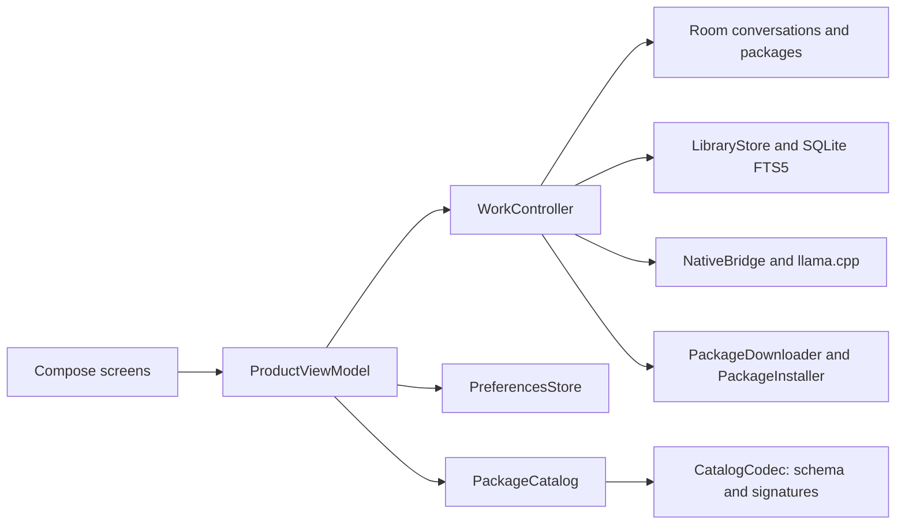

# Blobs architecture

Blobs runs inference, retrieval, citations, and source reading on Android using installed files. Network access is limited to user-requested downloads and signed download-list checks. There is no account or hosted inference service.

## Application structure

One Gradle application module contains the Compose UI, Room storage, SQLite FTS5 retrieval, and JNI integration with a pinned llama.cpp CPU runtime. `AppContainer` composes app-scoped objects; `ProductViewModel` owns navigation and UI actions; `WorkController` coordinates exclusive answer, import, and package operations and their cancellation.



Feature screens live in `feature/`; shared application UI lives in `ui/`. `data/local` owns Room entities, DAOs, and explicit migrations; `data/library` owns source access, retrieval, and document import; `data/packages` owns asset identity, validation, downloading, and installation. `inference` owns answer formatting and grounding, with JNI code in `app/src/main/cpp`. The host-side `corpus/blobs_corpus` package owns corpus preparation and the shared `.blobs` archive contract reused by Android tools.

## Retrieval and answers

`LibraryStore` searches enabled libraries or the user's selected document scope. Article names, aliases, and requested sections guide selection. Named subjects receive coverage before additional passages from the same subject; identical passages from overlapping packs are removed. A confident broad definition stays within the matched article and its subarticles. Response-length instructions are removed from search terms while the saved question retains its original wording.

Retrieval is bounded to six sources, 6,000 UTF-16 characters, and three passages per document. Generation receives the first four selected sources, with section and source/saved dates. Scoped FTS searches resolve document IDs before passage ranking; global searches keep the normal FTS rank path.

Explicit follow-ups retain a bounded lexical anchor: up to 300 characters from the latest standalone question and 300 from subsequent questions. The model also receives an excerpt of the last two turns. This is lexical context rather than semantic pronoun resolution.

If native tokenization rejects an oversized prompt, generation first drops the conversation excerpt, then tries shorter source excerpts. It preserves the full question, conversation topic, source order, and IDs. Saved evidence matches the excerpts supplied to the successful attempt. If the question still exceeds the reading limit, the app explains how to shorten it. These retries happen before prefill or streamed output; other errors and cancellation do not trigger retries.

Complete and token-limited answers pass the same lexical citation check on the original visible output, before display formatting removes unavailable references. Every cited source must contribute lexical overlap; invalid IDs reject completion. Rejected final output is cleared and saved as unverified; partial text may already have appeared while streaming. Recognized English requests for live information receive an app-authored offline-reference notice. Neither mechanism proves semantic correctness or freshness. Sources remain snapshots, and citations let users inspect what an answer relies on.

## Native runtime and memory

The runner retains one model and a bounded context while the app is active. It reuses only an exact prompt prefix, removes the following cached tokens, and evaluates at least the final input token to refresh logits. A changed model, insufficient capacity, unsupported memory removal, interrupted prefill, or decode failure requires a fresh context. Cancellation retains a completed prompt only when the runtime confirms valid positions and can remove the generated tail.

Context capacity is at most 4,096 tokens, with 3,072 input and 768 output tokens. No context cache is written to disk. Backgrounding the app or releasing the model clears native weights and context.

## Assets and installation

GitHub hosts source and APK releases. The Hugging Face dataset [`nonomnonom/blobs-catalog`](https://huggingface.co/datasets/nonomnonom/blobs-catalog) hosts the signed download list and installable packages; Gemma weights come from pinned upstream repositories. Installed assets, conversations, and settings stay in app-private storage.

Setup recommends a model from locally available memory and storage. Downloads start after the user chooses them. Blobs verifies signed metadata, byte count, SHA-256, package paths, storage bounds, and SQLite/GGUF format before atomic installation. A failed operation leaves the previous working asset intact. Installing or enabling another library edition disables other editions in one database transaction while retaining their files for manual rollback.

Opening a screen does not check for updates. **Check for updates** fetches and caches a verified signed list; bundled or cached choices remain available offline. Updating the list does not download assets or remove installed files.

Document import supports TXT, Markdown, CSV, JSON, and text-based PDF. Limits are 50 files and 25 MiB input per collection, 10 MiB per file with a 25 MiB allowance for JSON, 200 PDF pages, one million Unicode code points per document, and five million per collection. OCR, scanned-image PDFs, and protected PDFs are unsupported. Imports use the same installation path and can be disabled, exported as JSON, or removed.

## Trust and publishing

Catalog envelopes use ECDSA P-256 with SHA-256. New builds trust the embedded v2 public key; v1 is retired. Key rotation requires an app update. Keep private keys outside Git and release artifacts.

Lists carry an increasing positive `revision`. Before replacing its cache, the app atomically records the highest accepted revision and payload digest. It rejects older revisions and different payloads with the same revision. The bundled list sets the minimum for fresh installs. The same accepted payload can restore a missing cache; a damaged revision record blocks online refresh while installed assets and bundled metadata remain usable. Restoring app data can restore an older boundary, so this is not hardware-backed rollback protection.

Before distributing an asset, review origin, redistribution rights, attribution, compatibility, size, and digest. Corrections require a new immutable package edition. The publisher validates archive digests and manifests, uploads only allowed README/package files, pins immutable Hugging Face URLs, signs the list, and updates the bundled fallback. It writes exact UTF-8/LF payload bytes before signing; reformatting requires a new revision.

From `android/`, with reviewed assets staged and an explicit revision greater than all published revisions:

```powershell title="Publish assets"
uv run --locked --project ../corpus --group publisher python tools/publish_hf_assets.py --revision NEXT_REVISION
```

See [corpus preparation](https://github.com/nonomnonom/blobs/blob/main/corpus/README.md) for source records, [Android releases](https://github.com/nonomnonom/blobs/blob/main/android/docs/RELEASE.md) for APK signing, and [Contributing](https://github.com/nonomnonom/blobs/blob/main/CONTRIBUTING.md) for development checks.
