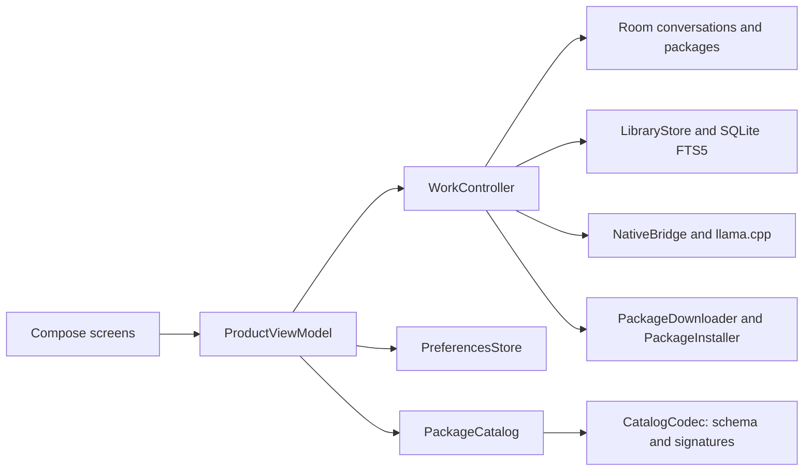

# Blobs architecture

Blobs is an offline-first Android research app with an online, curated asset library. After setup, model inference, retrieval, citations, and reading use files stored on the device. Network access is limited to explicit package downloads and signed download-list checks.

## Application structure

The Android app uses one Gradle application module. `AppContainer` composes app-scoped storage, package, retrieval and work objects. `ProductViewModel` owns navigation and UI actions; `ProductState` and `WorkState` describe the state consumed by Compose. `WorkController` coordinates exclusive answer, import and package operations and their cancellation. Feature screens live under `feature/`, with setup and settings in their own folders and shared package cards beside library screens.



`data/local` owns Room entities, DAOs and explicit migrations. `data/library` owns read-only source access, retrieval and document import. `data/packages` owns package identity, validation, downloading, installation and the curated download list. `inference` owns model integration, answer formatting and grounding checks; JNI code lives in `app/src/main/cpp`. The uv-managed `corpus/blobs_corpus` package owns corpus preparation and the shared `.blobs` archive contract. Android preparation scripts reuse that contract rather than maintaining a second builder.

These are source boundaries within the current application, not separate services or independently deployed modules. Contributor commands and compatibility rules are in [Contributing](../CONTRIBUTING.md).

## Where files live

- GitHub hosts the app source, build and verification tools, and Android releases.
- The public Hugging Face dataset [`nonomnonom/blobs-catalog`](https://huggingface.co/datasets/nonomnonom/blobs-catalog) hosts the signed package list, Blobs-formatted Qwen model package, starter library, and optional libraries. Reviewed travel-record shards for corpus rebuilds are hosted there too; see the [corpus guide](../corpus/README.md#download-reviewed-travel-records-from-hugging-face). Files are pinned by repository revision, byte count, and SHA-256.
- Gemma model weights are downloaded from their upstream Hugging Face repositories at pinned revisions.
- Installed models, libraries, conversations, and settings remain in app-private storage.

The list is curated by Blobs maintainers. It is not an unrestricted index of Hugging Face, and it never triggers an asset download by itself.

## First run and updates

1. Blobs reads available memory and storage locally and recommends a compatible model. The user chooses whether to accept the recommendation or select another listed model.
2. Setup downloads the selected model and required starter library only after the user taps the download action. The size and available-space guidance appear before each download.
3. The app verifies the signed package metadata, pinned byte count, SHA-256, and package format before validating and installing files atomically.
4. Optional libraries can be downloaded from the in-app Library screen. Users can remove installed assets to reclaim space.
5. Blobs never checks for updates in the background or just because a screen opens. The user can tap “Check for updates” in Library or Models; that fetches the signed download list and caches the verified result. Blobs uses the cached or bundled list offline.

Users can also add their own TXT, Markdown, CSV, JSON, and text-based PDF files from the phone. Blobs extracts text locally, builds a searchable SQLite FTS5 library, and installs it through the same integrity-checked package path as downloaded libraries. Import is bounded to 50 files, 25 MB total input, 10 MB per ordinary file, 200 PDF pages, and 5 million Unicode code points per collection. Scanned-image PDFs, OCR, password-protected PDFs, and certificate-encrypted PDFs are not supported. Each saved collection can be switched off for retrieval, exported as a portable JSON pack, or removed. These collections stay in app-private storage unless the user explicitly exports them.

No catalog request or model/library download starts in the background. A failed or interrupted install leaves the previous working asset intact. Once setup is complete, network access is unnecessary for chat and research; online catalog checks and downloads start only after the user asks for them.

## Trust and publishing

Catalog envelopes use ECDSA P-256 with SHA-256. The app embeds the current trusted public key (v2); the retired v1 key is no longer accepted by new builds. Key rotation ships with an app update so the trusted key set remains part of the reviewed application source. The signing key is kept outside Git and release artifacts. Each package reference points to an immutable Hugging Face revision; package size and SHA-256 are checked before installation. Model and library payloads also pass format, path, storage, and database validation.

Before publishing an asset, maintainers verify its origin, redistribution rights, license and attribution, package compatibility, size, and digest. A corrected asset is published as a new immutable package version and catalog entry; removing an entry does not silently remove a user's installed files.

The repeatable Hugging Face publisher is `android/tools/publish_hf_assets.py`. It checks staged assets against the app's package list, publishes only the allow-listed README and package files, pins URLs to the resulting revision, signs the refreshed list, and updates the app's bundled fallback list. GitHub remains the source and APK distribution channel.

Signed lists carry a positive increasing `revision`. The app atomically records the highest accepted revision and its payload digest before replacing the cached list. It rejects older revisions and different payloads reusing the same revision. The bundled list supplies a minimum revision for fresh installs. A missing list cache can be restored from the same accepted payload; a damaged revision record blocks online refresh while bundled metadata and installed libraries remain available. Restoring private app data can also restore an older revision boundary; this is not hardware-backed rollback protection.

The publisher writes the payload as UTF-8 with LF line endings before signing and copies those exact bytes into the bundled list. This keeps its digest stable across Windows builds and Git checkouts. Formatting or content changes require a new revision; do not reformat an already signed payload.

Publish with an explicit revision greater than every previously published revision:

```powershell
uv run --locked --project ../corpus --group publisher python tools/publish_hf_assets.py --revision NEXT_REVISION
```

The publisher validates staged archives against both their full digest and embedded manifest before upload. Installed starter editions remain usable when an update is advertised. Installing or enabling a library edition disables other editions of that library in one database transaction and retains their files for manual rollback.
